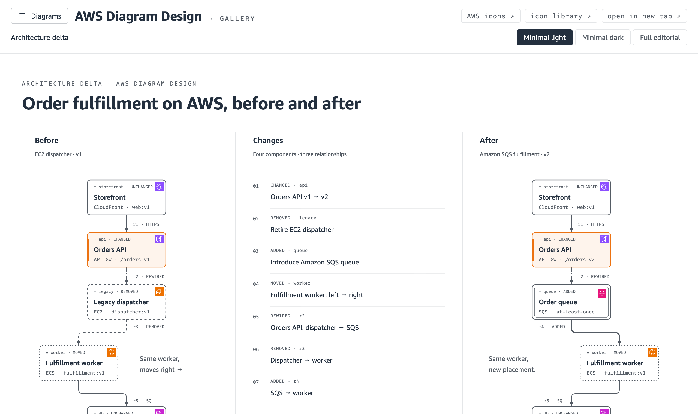
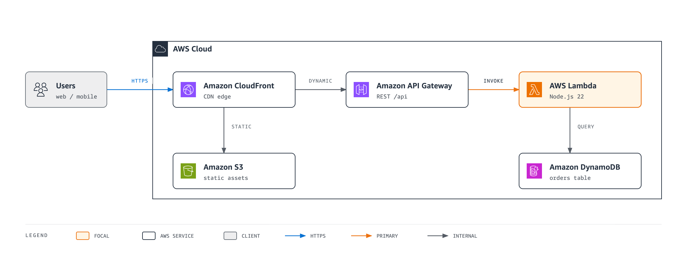
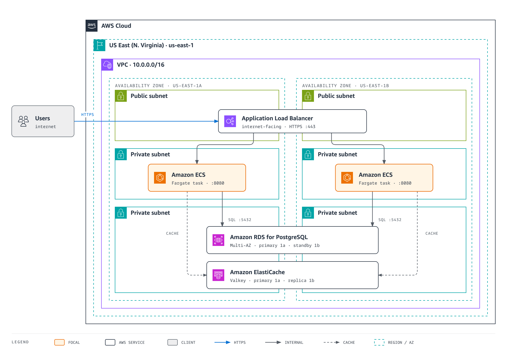
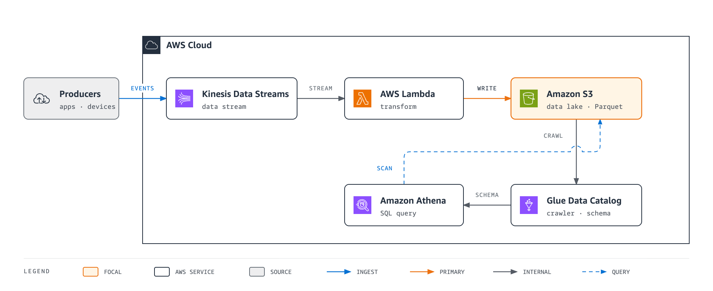
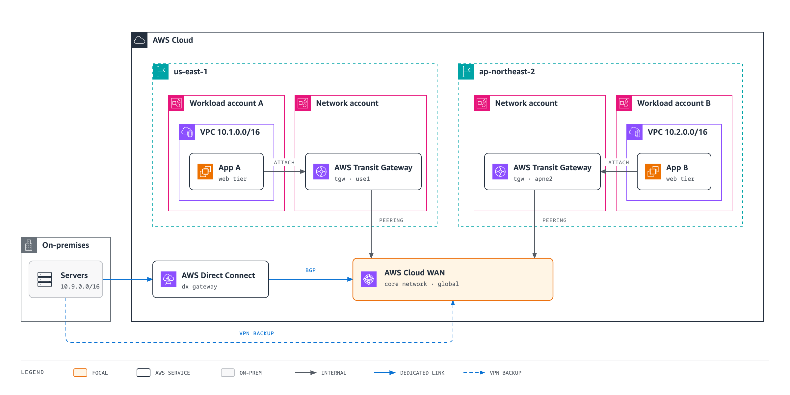
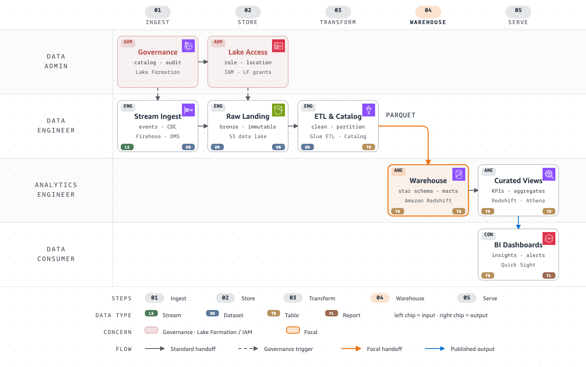

# AWS Diagram Design Skill (aws-diagram-design)

[한국어](README.md) | **English** · [Gallery](https://masangbeom.github.io/aws-diagram-design/)

**Describe it in words, get an AWS diagram.**

> [!TIP]
> **👉 See the results first in the [online gallery](https://masangbeom.github.io/aws-diagram-design/).**
> 201 AWS examples across 45 types, in light, dark, and full-page variants. Nothing to install; it opens in your browser.

[](https://masangbeom.github.io/aws-diagram-design/)

Instead of hand-drawing architectures in draw.io, just tell Claude Code or Kiro:

> "Draw a three-tier VPC diagram — Fargate service behind an ALB, with RDS Multi-AZ and ElastiCache"

You get a self-contained HTML diagram with the [official AWS Architecture Icons](https://aws.amazon.com/architecture/icons/), Amazon Ember typography, and the official VPC / subnet / account container conventions — exportable to SVG/PNG on demand. The goal is quality you can drop straight into proposals, wikis, slide decks, and architecture reviews.

## What it draws

- **Architecture diagrams**: serverless, VPC networking, multi-account / multi-region, hybrid (Direct Connect / VPN). VPC, subnet, Region, and account boundaries follow the official group-container color and badge conventions.
- **Everything else your design docs need**: flowcharts, sequence diagrams, state machines, ER and database schemas, timelines, swimlanes, Gantt charts, org charts, layer stacks, data flows, deployment and dependency graphs, architecture before/after deltas, waterfall, Sankey, treemap and heatmap charts, service blueprints, Wardley maps — 45 visual types in total.
- **Redrawing existing diagrams**: reads your draw.io (.drawio) or Mermaid (.mmd) files and redraws them at the size and detail level you choose (doc / slide / summary) while preserving the content.

Any node that names an AWS service gets its official icon — in every diagram type, not just architecture — on top of a restrained editorial design system (based on [cathrynlavery/diagram-design](https://github.com/cathrynlavery/diagram-design) 2.6) that limits emphasis to one or two smile-orange focal elements.

## Diagrams that hold up to an AWS engineer

It isn't enough to look like AWS. Every type carries **On AWS** rules that the skill applies while drawing, so an AWS engineer finds nothing wrong:

- **Placement is a claim**: regional services such as S3, DynamoDB, and SQS sit outside the VPC and are reached through VPC endpoints. Global services such as CloudFront, Route 53, and IAM sit outside the Region. Internet-facing ALBs and NAT gateways go in public subnets.
- **Multi-AZ is drawn**: a Multi-AZ resource spans the AZ columns. It is never placed in one AZ with only a label claiming Multi-AZ.
- **Official service names**: the first mention carries the correct prefix (`AWS Lambda`, `Amazon EC2`), later mentions use the short form, and current names are used (Amazon SageMaker AI, Amazon Data Firehose).
- **Real behavior**: synchronous vs asynchronous calls (`202`, `MessageId`), Step Functions states (`ABORTED`, …), and CDK deploying through CloudFormation follow what AWS actually does.
- **Contrast**: in the light skin, smile orange is used for strokes, markers, and fills only, never for small text (WCAG).

Icons are found and inlined with the bundled `scripts/aws_icon.py` (`aws_icon.py find dynamodb`), and every output is checked by `scripts/self_check.py` (accessibility, single-file safety, document completeness).

## Gallery

Everything below was generated by this skill. Source HTML, SVG, and PNG live in [docs/samples/](docs/samples/).

### Serverless Web Application

The most common starting point: CloudFront splits traffic between S3 static assets and the API Gateway → Lambda → DynamoDB dynamic path. ([HTML](docs/samples/serverless-web-app.html) · [SVG](docs/samples/serverless-web-app.svg))



### VPC Three-Tier Web Service

The canonical layout: two Availability Zones in us-east-1 (1a/1b), each with public, app, and data subnets. An internet-facing ALB spanning both AZs sends traffic to an ECS on Fargate task in each AZ, and an RDS for PostgreSQL Multi-AZ instance (primary 1a · standby 1b) and an ElastiCache (Valkey) replication group are drawn across both data subnets. The AWS Cloud ⊃ Region ⊃ VPC ⊃ AZ ⊃ subnet boundaries and badges follow the official convention. ([HTML](docs/samples/vpc-three-tier.html) · [SVG](docs/samples/vpc-three-tier.svg))



### Event-Driven Data Pipeline

Streaming ingestion through Kinesis Data Streams → AWS Lambda → Amazon S3 data lake, with an analytics path where Amazon Athena scans S3 directly via the Glue Data Catalog. Crossing connectors are handled with the bridge/hop primitive. ([HTML](docs/samples/event-driven-pipeline.html) · [SVG](docs/samples/event-driven-pipeline.svg))



### Multi-Region Network Backbone

The canonical multi-account, multi-region network shape: per-region AWS Transit Gateways in network accounts peer into an AWS Cloud WAN core, and on-premises connects over AWS Direct Connect (BGP) with a Site-to-Site VPN backup. ([HTML](docs/samples/multi-region-network.html) · [SVG](docs/samples/multi-region-network.svg))



### AWS Data Pipeline Flow

A role-scoped data flow showing who does what at each stage. A Data Admin hands down Lake Formation catalog governance and IAM access as dashed triggers; beneath that, Firehose/DMS ingestion → S3 lake → Glue ETL → Redshift warehouse (the focal handoff) → Quick Sight dashboards. Official service icons on every node, with payload-type chips tracing the transformation (stream → dataset → table → report). ([HTML](docs/samples/data-pipeline-flow.html) · [SVG](docs/samples/data-pipeline-flow.svg))



> The images above are PNGs rendered in Amazon Ember. The SVGs are standalone exports, but GitHub's image viewer blocks external fonts, so they display in a system font there; open the HTML in a browser to see the diagrams exactly as drawn.

### Full gallery

201 examples across all 45 types (light, dark, and full editorial page, plus some animated) are all AWS scenarios. Examples include an EC2 → Fargate migration before/after, a Cognito token-refresh sequence, a Step Functions batch-job lifecycle, an S3 data lake, AWS cost waterfall and treemap charts, and an Organizations OU tree. The skill uses them as the reference render for each type.

**Online gallery: [masangbeom.github.io/aws-diagram-design/](https://masangbeom.github.io/aws-diagram-design/)** (GitHub Pages, redeployed on every merge to `main`)

To browse locally:

```bash
python3 -m http.server 8765 --directory skills/aws-diagram-design/assets
# → http://127.0.0.1:8765/index.html
```

Pick a type and variant from the list at the top, and switch between light, dark, and full page with the tabs at the top right. `aws-icons.html` is a gallery of the 812 bundled official icons.

## Getting started

### Claude Code

```
/plugin marketplace add masangbeom/aws-diagram-design
```
```
/plugin install aws-diagram-design@aws-diagram-design
```
```
/reload-plugins
```

If you've cloned the repo locally, a path works too: `/plugin marketplace add /path/to/aws-diagram-design`.

### Kiro (IDE / CLI)

```bash
./install.sh kiro            # copy into ~/.kiro/skills/ (--workspace: project-local, --link: symlink)
```

Kiro reads Anthropic-format Agent Skills natively, so no conversion is needed. See [docs/guide-kiro.md](docs/guide-kiro.md) for registering it as a Power.

### Fonts (optional)

```bash
./install.sh fonts           # install the bundled Amazon Ember TTFs into your OS font directory
```

Amazon Ember is bundled with the skill from [Amazon's official distribution](https://developer.amazon.com/en-US/alexa/branding/echo-guidelines/identity-guidelines/typography) (`skills/aws-diagram-design/assets/fonts/`). Generated diagrams resolve fonts in this order: locally installed copy → bundled woff2 → Helvetica — so everything works even if you skip this step.

## How to use it

Just ask in plain language:

```
"Draw the architecture for this project — ArgoCD on EKS, RDS Multi-AZ"
"Transit Gateway hub-and-spoke network diagram, three accounts"
"Sequence diagram for order processing on AWS — API Gateway, Lambda, SQS, DynamoDB"
"Turn this onboarding process into a swimlane"
```

Redraw existing files and export with slash commands:

```
/aws-diagram-design:import-drawio legacy-arch.drawio     # redraw a draw.io file
/aws-diagram-design:import-mermaid pipeline.mmd          # redraw a Mermaid file
/aws-diagram-design:export-diagram my-diagram.html       # export generated HTML to SVG/PNG
```

When redrawing you can pick the size (doc inline / wide / 16:9 slide / A3 print / social card), detail level (faithful / balanced / simplified), and audience (engineer / mixed / executive); anything merged or dropped is reported in a fidelity ledger.

Export runs the bundled scripts (`export_svg.py`, `export_png.py`). The SVG is a standalone file that carries the page CSS and the Amazon Ember `@font-face`, with colors normalized so PowerPoint doesn't break them. PNG export requires Playwright in the environment.

## Official AWS resources, used as-is

| Resource | Details |
|---|---|
| [AWS Architecture Icons](https://aws.amazon.com/architecture/icons/) | Official icon package (release 07312026), 812 icons bundled: 305 service, 466 resource, 15 group, 26 category. Used unmodified and unrecolored, in every diagram type — not just architecture. Gallery: `assets/aws-icons.html` |
| Group container conventions | Official boundary colors, badges, and dash rules for AWS Cloud, accounts, Regions, VPCs, public/private subnets, security groups, and more |
| [Amazon Ember](https://developer.amazon.com/en-US/alexa/branding/echo-guidelines/identity-guidelines/typography) | Officially distributed font bundle (woff2 + TTF), forming the AWS brand skin together with the squid ink `#232F3E` + smile orange `#EC7211`/`#FF9900` palette |

## Repository layout

```
aws-diagram-design/
├── .claude-plugin/                 # Claude Code plugin manifest + marketplace catalog
├── .github/workflows/pages.yml     # deploys the gallery to GitHub Pages
├── plugin.json                     # Agent Plugins manifest (for Kiro Powers)
├── commands/                       # 3 slash commands (import-drawio / import-mermaid / export-diagram)
├── skills/aws-diagram-design/      # canonical skill (shared by every environment)
│   ├── SKILL.md                    #   design system + routing for the 45 types
│   ├── references/                 #   58 specs (style-guide, 45 type-* with On AWS rules, primitive-aws-icons, …)
│   ├── assets/                     #   templates, 201 AWS examples + gallery (index.html), aws-icons/ 812 SVGs, fonts/ Amazon Ember
│   └── scripts/                    #   self-checks (self_check, verify-geometry), drawio/mermaid extractors, SVG/PNG exporters (export_svg, export_png), AWS icon inliner (aws_icon)
├── scripts/                        # 20 repo-level verifiers (geometry, motion, per-chart) + 9 tests + fixtures
├── docs/                           # per-environment guides + samples/ example diagrams
└── install.sh                      # claude-code · kiro · fonts installers
```

## License

MIT. See [THIRD_PARTY_LICENSES.md](THIRD_PARTY_LICENSES.md) for third-party notices. The AWS Architecture Icons are governed by the [AWS icon terms](https://aws.amazon.com/architecture/icons/) (no modification or recoloring), and Amazon Ember by the licensing guidelines bundled alongside the fonts.
