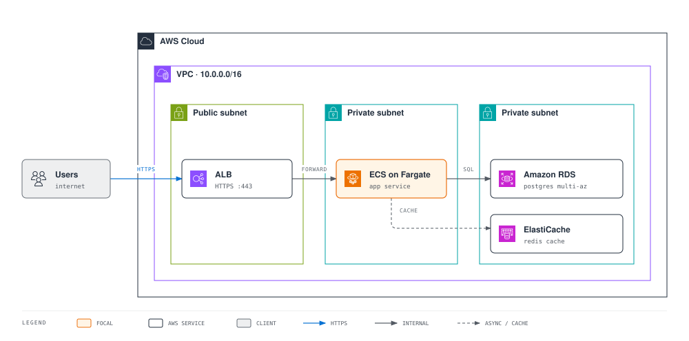
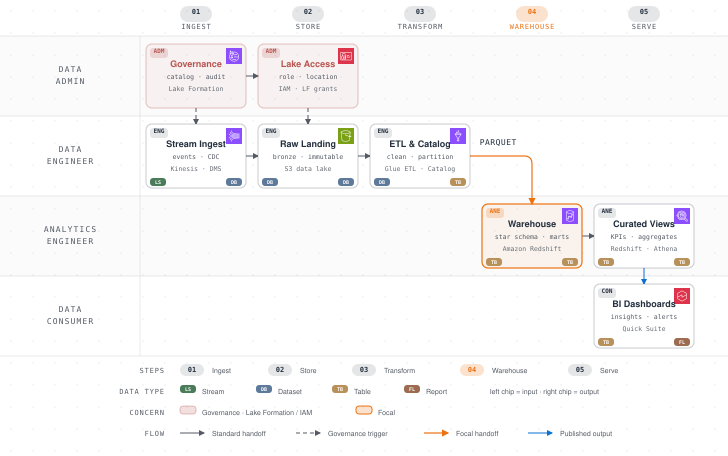

# AWS Diagram Design Skill (aws-diagram-design)

[한국어](README.md) | **English**

**Describe it in words, get an AWS diagram.**

Instead of hand-drawing architectures in draw.io, just tell Claude Code or Kiro:

> "Draw a three-tier VPC diagram — Fargate service behind an ALB, with RDS Multi-AZ and ElastiCache"

You get a self-contained HTML diagram with the [official AWS Architecture Icons](https://aws.amazon.com/architecture/icons/), Amazon Ember typography, and the official VPC / subnet / account container conventions — exportable to SVG/PNG on demand. The goal is quality you can drop straight into proposals, wikis, slide decks, and architecture reviews.

## What it draws

- **Architecture diagrams**: serverless, VPC networking, multi-account / multi-region, hybrid (Direct Connect / VPN). VPC, subnet, Region, and account boundaries follow the official group-container color and badge conventions.
- **Everything else your design docs need**: flowcharts, sequence diagrams, state machines, ER and database schemas, timelines, swimlanes, Gantt charts, org charts, layer stacks, data flows, deployment and dependency graphs, architecture before/after deltas, waterfall, Sankey, treemap and heatmap charts, service blueprints, Wardley maps — 45 visual types in total.
- **Redrawing existing diagrams**: reads your draw.io (.drawio) or Mermaid (.mmd) files and redraws them at the size and detail level you choose (doc / slide / summary) while preserving the content.

Any node that names an AWS service gets its official icon — in every diagram type, not just architecture — on top of a restrained editorial design system (based on [cathrynlavery/diagram-design](https://github.com/cathrynlavery/diagram-design)) that limits emphasis to one or two smile-orange focal elements.

## Gallery

Everything below was generated by this skill. Source HTML lives in [docs/samples/](docs/samples/).

### Serverless Web Application

The most common starting point: CloudFront splits traffic between S3 static assets and the API Gateway → Lambda → DynamoDB dynamic path. ([HTML](docs/samples/serverless-web-app.html))



### VPC Three-Tier Web Service

ALB in a public subnet → ECS on Fargate in a private subnet → RDS and ElastiCache in a data subnet. Subnet boundary colors and badges follow the official convention exactly. ([HTML](docs/samples/vpc-three-tier.html))



### Event-Driven Data Pipeline

Streaming ingestion through Kinesis → Lambda → S3 data lake, with an analytics path where Athena scans S3 directly via the Glue catalog. Crossing connectors are handled with the bridge/hop primitive. ([HTML](docs/samples/event-driven-pipeline.html))


### Multi-Region Network Backbone

The canonical multi-account, multi-region network shape: per-region Transit Gateways in network accounts peer into an AWS Cloud WAN core, and on-premises connects over Direct Connect (BGP) with a Site-to-Site VPN backup. ([HTML](docs/samples/multi-region-network.html))


### AWS Data Pipeline Flow

A role-scoped data flow showing who does what at each stage. A Data Admin hands down Lake Formation catalog governance and IAM access as dashed triggers; beneath that, Kinesis/DMS ingestion → S3 lake → Glue ETL → Redshift warehouse (the focal handoff) → Quick Suite dashboards. Official service icons on every node, with payload-type chips tracing the transformation (stream → dataset → table → report). ([HTML](docs/samples/data-pipeline-flow.html))



> GitHub blocks external fonts when rendering images, so the SVGs above display in system fonts. Open the HTML sources in a browser to see the real Amazon Ember typography.

## Getting started

### Claude Code

```
/plugin marketplace add masangbeom/aws-diagram-design
```
```
/plugin install aws-diagram-design@aws-diagram-design
```
```
/reload-plugins
```

If you've cloned the repo locally, a path works too: `/plugin marketplace add /path/to/aws-diagram-design`.

### Kiro (IDE / CLI)

```bash
./install.sh kiro            # copy into ~/.kiro/skills/ (--workspace: project-local, --link: symlink)
```

Kiro reads Anthropic-format Agent Skills natively, so no conversion is needed. See [docs/guide-kiro.md](docs/guide-kiro.md) for registering it as a Power.

### Fonts (optional)

```bash
./install.sh fonts           # install the bundled Amazon Ember TTFs into your OS font directory
```

Amazon Ember is bundled with the skill from [Amazon's official distribution](https://developer.amazon.com/en-US/alexa/branding/echo-guidelines/identity-guidelines/typography) (`skills/aws-diagram-design/assets/fonts/`). Generated diagrams resolve fonts in this order: locally installed copy → bundled woff2 → Helvetica — so everything works even if you skip this step.

## How to use it

Just ask in plain language:

```
"Draw the architecture for this project — ArgoCD on EKS, RDS Multi-AZ"
"Transit Gateway hub-and-spoke network diagram, three accounts"
"Sequence diagram for order processing on AWS — API Gateway, Lambda, SQS, DynamoDB"
"Turn this onboarding process into a swimlane"
```

Redraw existing files and export with slash commands:

```
/aws-diagram-design:import-drawio legacy-arch.drawio     # redraw a draw.io file
/aws-diagram-design:import-mermaid pipeline.mmd          # redraw a Mermaid file
/aws-diagram-design:export-diagram my-diagram.html       # export generated HTML to SVG/PNG
```

When redrawing you can pick the size (doc inline / wide / 16:9 slide / social card), detail level (faithful / balanced / simplified), and audience (engineer / mixed / executive); anything merged or dropped is reported in a fidelity ledger.

## Official AWS resources, used as-is

| Resource | Details |
|---|---|
| [AWS Architecture Icons](https://aws.amazon.com/architecture/icons/) | Official icon package (release 07312026), 812 icons bundled: 305 service, 466 resource, 15 group, 26 category. Used unmodified and unrecolored, in every diagram type — not just architecture. Gallery: `assets/aws-icons.html` |
| Group container conventions | Official boundary colors, badges, and dash rules for AWS Cloud, accounts, Regions, VPCs, public/private subnets, security groups, and more |
| [Amazon Ember](https://developer.amazon.com/en-US/alexa/branding/echo-guidelines/identity-guidelines/typography) | Officially distributed font bundle (woff2 + TTF), forming the AWS brand skin together with the squid ink `#232F3E` + smile orange `#EC7211`/`#FF9900` palette |

## Repository layout

```
aws-diagram-design/
├── .claude-plugin/                 # Claude Code plugin manifest + marketplace catalog
├── plugin.json                     # Agent Plugins manifest (for Kiro Powers)
├── commands/                       # 3 slash commands (import-drawio / import-mermaid / export-diagram)
├── skills/aws-diagram-design/      # canonical skill (shared by every environment)
│   ├── SKILL.md                    #   design system + routing for the 45 types
│   ├── references/                 #   58 specs (style-guide, type-*, primitive-aws-icons, …)
│   ├── assets/                     #   templates & examples, aws-icons/ 812 SVGs, fonts/ Amazon Ember
│   └── scripts/                    #   self-checks (self_check, verify-geometry), drawio/mermaid extractors, SVG/PNG exporters (export_svg, export_png), AWS icon inliner (aws_icon)
├── scripts/                        # repo-level verification scripts + test fixtures
├── docs/                           # per-environment guides + samples/ example diagrams
└── install.sh                      # claude-code · kiro · fonts installers
```

## License

MIT. See [THIRD_PARTY_LICENSES.md](THIRD_PARTY_LICENSES.md) for third-party notices. The AWS Architecture Icons are governed by the [AWS icon terms](https://aws.amazon.com/architecture/icons/) (no modification or recoloring), and Amazon Ember by the licensing guidelines bundled alongside the fonts.
